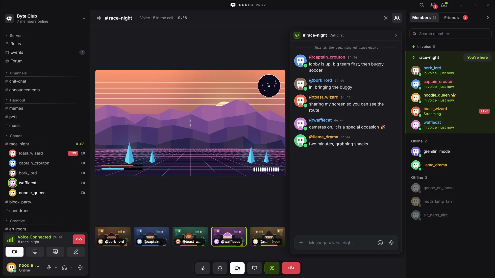
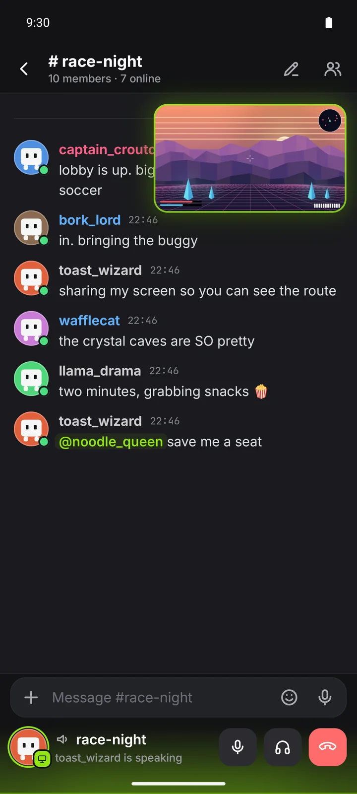
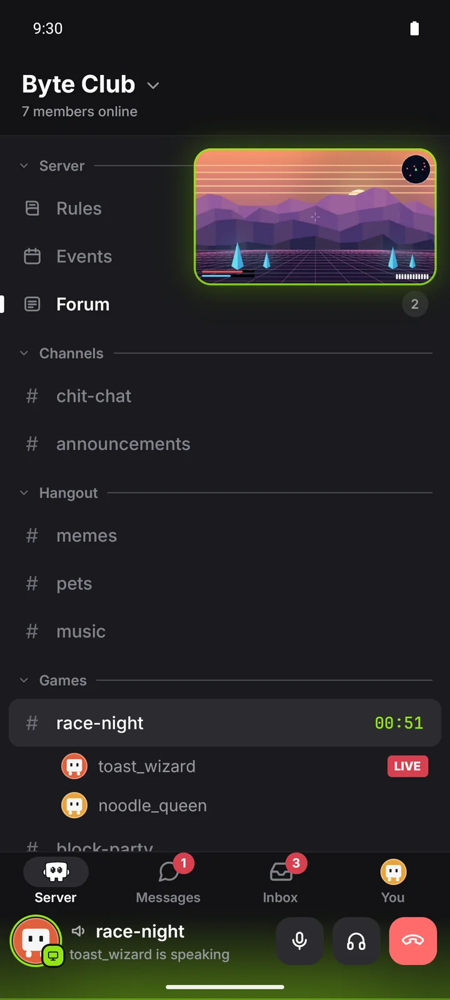
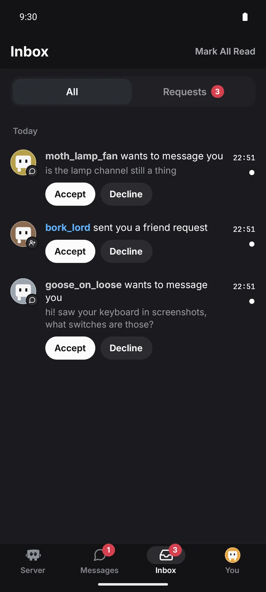
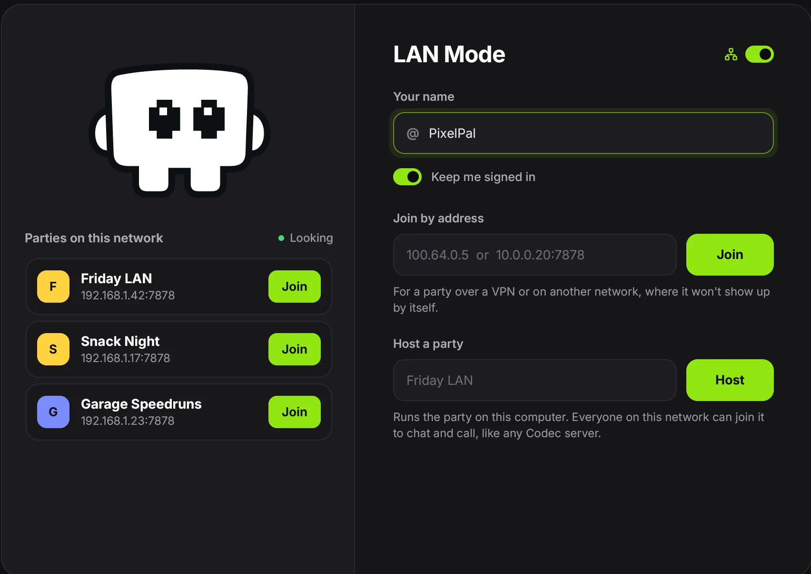
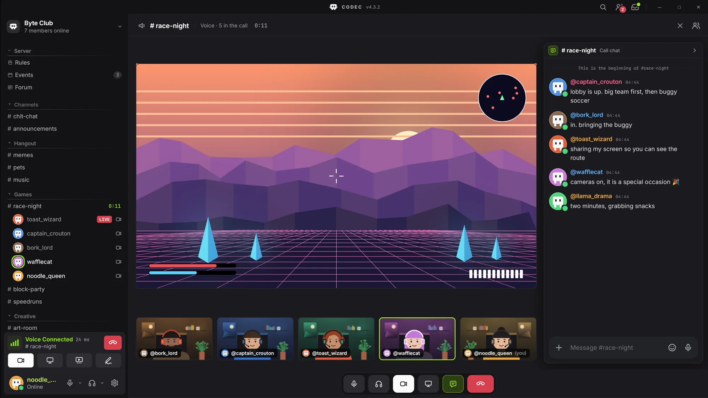
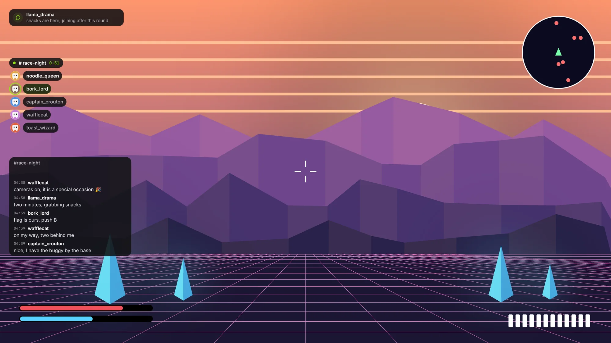
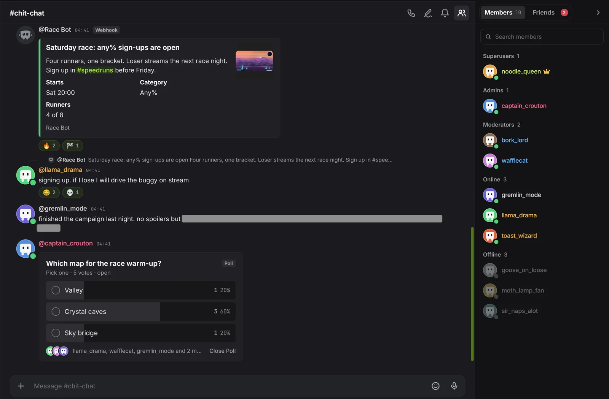
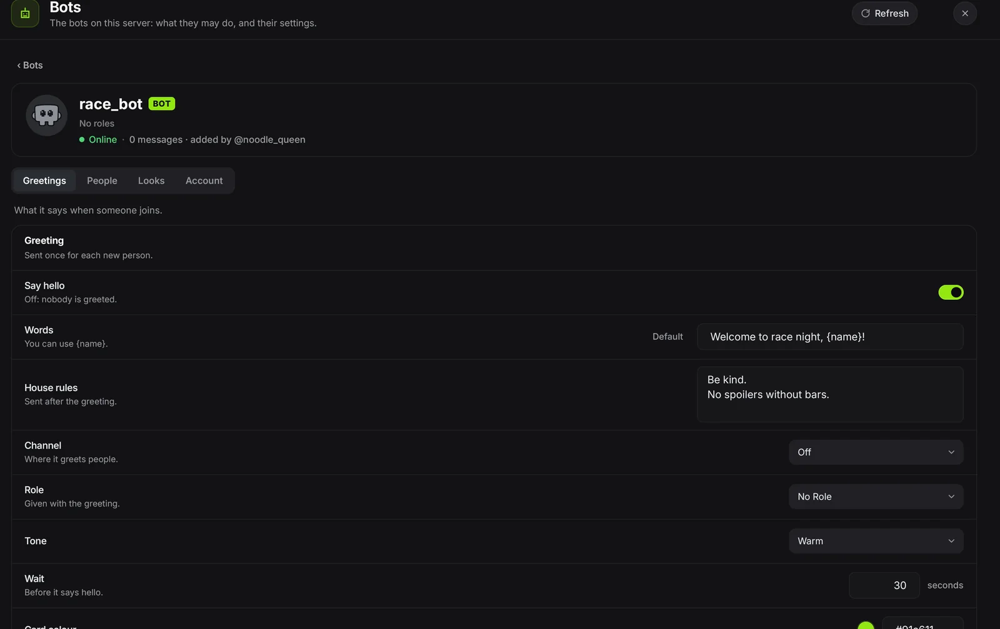
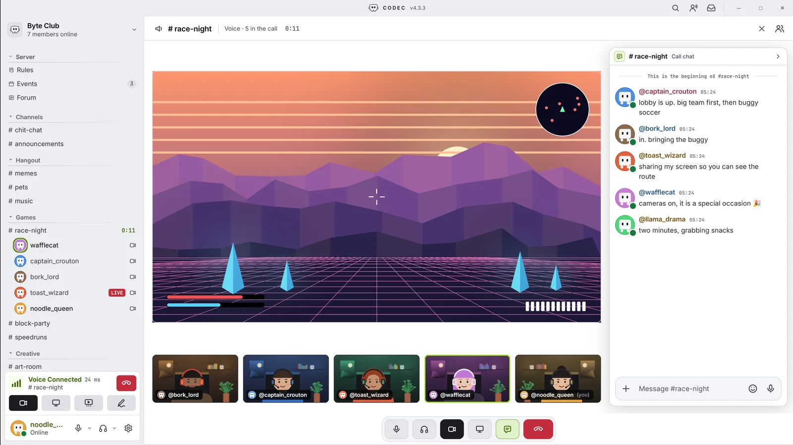

<p align="center">
  
</p>

<h1 align="center">Codec</h1>

<p align="center"><b>Own the room.</b><br>
Voice, video and chat on a server you run. Written in Rust, for Windows, Linux and Android.</p>

<p align="center">
  <a href="https://github.com/uhd3mon/codec/releases/latest/download/Codec-Setup.exe"><b>Windows</b></a> ·
  <a href="https://github.com/uhd3mon/codec/releases/latest/download/Codec.AppImage"><b>Linux</b></a> ·
  <a href="https://github.com/uhd3mon/codec/releases/latest/download/Codec.apk"><b>Android</b></a> ·
  <a href="#run-a-server"><b>Run a server</b></a> ·
  <a href="https://d3mon.gg/codec/docs"><b>Docs</b></a> ·
  <a href="https://d3mon.gg/codec"><b>Website</b></a>
</p>

<p align="center"></p>

You run the server, or you join someone else's. No ads, no trackers.

## What's inside

| | |
|---|---|
| **[Native Rust app](#rust-all-the-way-down)** | Desktop, phone and server. No web browser hiding inside. |
| **[New mobile experience](#the-new-mobile-experience)** | A call bar on every page, floating video, one Inbox. |
| **[LAN Mode](#lan-mode-no-internet-needed)** | Host and join parties on your own network. |
| **[Voice, video and streams](#voice-video-and-streams)** | Through your server, with clean sound. |
| **[Codec Overlay](#codec-overlay)** | Over your game, in a call or not. |
| **[Chat, forums and friends](#chat-forums-and-friends)** | Voice messages, polls, sketchpad, events. |
| **[Bots](#bots-and-webhooks)** | Managed from inside Codec. |
| **[Themes](#themes)** | Dark, light and any accent. |

## Rust, all the way down

- The **desktop app** is drawn on your graphics chip with GPUI. The **Android
  app** uses the same Rust core and drawing code.
- The **server** is one Rust program (Axum and SQLite) with its own media
  server (str0m). No database server to set up.
- The desktop app checks every update's signature before installing it.

## The new mobile experience

<p align="center">
  
  
  
</p>

- **A call bar that glows.** It's on every page during a call, says who is
  speaking, and has mute, deafen and hang up.
- **Floating video.** Drag the stream you watch, pinch it, or slide it off the
  edge to hide it.
- **One Inbox.** Read it on one device and it's read on all of them.

Needs Android 8 or newer on a 64-bit ARM phone.

## LAN Mode: no internet needed

<p align="center"></p>

- Flip **LAN Mode** on the sign-in screen: Codec lists the parties on your
  network. Join with just a name, from a computer or a phone.
- Press **Host** in the Windows or Linux app and your computer runs the party.
- Channels, calls, cameras, streams and the sketchpad all work offline.

## Voice, video and streams

<p align="center"></p>

- Noise suppression, echo cancellation, a noise gate, push to talk and a volume
  for each person.
- Stream a screen or a window, with your whole computer's sound or one app's.
  Up to 1440p at 60 frames a second, if the server allows it.
- Calls pass through your server: nobody in a call sees anyone else's address.

## Codec Overlay

<p align="center"></p>

Your call, its chat, a friend's stream, channels, notes and a livestream's chat
over your game. It works as long as Codec is running. <kbd>Shift</kbd>+<kbd>&#96;</kbd>
arranges it, <kbd>Ctrl</kbd>+<kbd>Shift</kbd>+<kbd>&#96;</kbd> hides it.

## Chat, forums and friends

<p align="center"></p>

- **Voice messages** up to 60 seconds, replies, reactions, polls, spoilers and
  up to 10 pictures a message.
- **Forums** for longer talks and **events** with reminders.
- A live **sketchpad** in every channel, with pictures you can draw over.
- **Friends** show the game they play or the call they're in, with Join.
- **Roles and permissions** per channel, reports and an audit log.

## Bots and webhooks

<p align="center"></p>

Press **Manage** and a bot's own settings open inside Codec. Bots can offer
slash commands, and webhooks post messages with embed cards from your scripts.

## Themes

<p align="center"></p>

Dark or light, and any accent colour. (The light theater is in Codec 4.3.3 and
newer.)

## Download

| System | Download |
|---|---|
| **Windows** (64-bit) | [Codec-Setup.exe](https://github.com/uhd3mon/codec/releases/latest/download/Codec-Setup.exe) |
| **Linux** (x86-64) | [Codec.AppImage](https://github.com/uhd3mon/codec/releases/latest/download/Codec.AppImage) |
| **Android** 8 or newer (64-bit ARM) | [Codec.apk](https://github.com/uhd3mon/codec/releases/latest/download/Codec.apk) |
| **Server** (Linux x86-64) | `codec-server-linux-amd64.tar.gz` on the [releases page](https://github.com/uhd3mon/codec/releases) |

**Linux:** make the file runnable, then start it:

```bash
chmod +x Codec.AppImage && ./Codec.AppImage
```

**Windows:** Codec isn't code-signed yet, so SmartScreen warns about the
installer: press **More info**, then **Run anyway**. With Smart App Control on,
Windows blocks it; [the docs](https://d3mon.gg/codec/docs/getting-started)
explain the options.

## Run a server

With Docker on a Linux machine (x86-64):

```bash
docker run -d --name codec --restart unless-stopped --network host -v codec-data:/data ghcr.io/uhd3mon/codec-server:latest
```

Open TCP and UDP **6670**, enter your server's address in the app and sign in as
**superuser** with the password **admin**. You pick a new one straight away.

More: [Docker](https://d3mon.gg/codec/docs/server-docker) ·
[Install without Docker](https://d3mon.gg/codec/docs/server-install) ·
[Settings file](https://d3mon.gg/codec/docs/server-config) ·
[Updates and backups](https://d3mon.gg/codec/docs/server-updates-backups)

## Docs

Everything, step by step: **[d3mon.gg/codec/docs](https://d3mon.gg/codec/docs)**.

## Licence

Codec is proprietary. It is free to download and use; the source is not
published. This repository holds this README and the releases. The full terms
are in the app under **Settings → About**.

Made by **Kevin Walters** (d3mon), and Byte.
